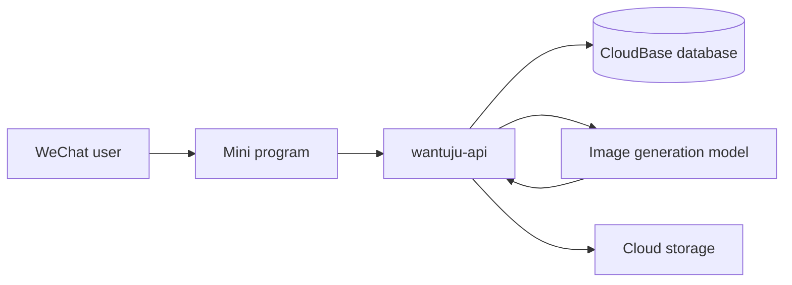

# Wantuju

English | [中文](README.zh-CN.md)

Wantuju (玩图局) is an open-source WeChat mini program for photo play modes. A person uploads a photo, picks a mode, and the backend asks an image generation model to transform or interpret that photo. Results can be saved and shared.

The mini program does not talk to the model directly. `cloudrun/wantuju-api`, a Python FastAPI service on WeChat CloudBase Run, owns the prompt, the model call, point charges, and cloud storage. New play modes are prompt configurations, so adding one does not require a new client release.

## Play modes

- **Palm reading.** Upload a palm photo and generate a playful reading.
- **Hairstyle.** Upload a front-facing photo and generate a hairstyle suggestion image.
- **Avatar.** Turn a portrait into a profile image.
- **Doodle.** Redraw a photo or sketch as a doodle illustration.
- **Crayon.** Redraw a photo with a crayon texture.
- **Soul portrait.** Generate a portrait from the mood of a photo.
- **Old-photo restore.** Repair a faded or damaged photograph.
- **Style transfer.** Recast a photo in another visual style.
- **Pet portrait.** Turn a pet photo into an anthropomorphic portrait.
- **Holiday photo.** Generate a portrait for a holiday theme.
- **Product shot.** Clean a product photo into a display image.

A new play mode goes live by writing its prompt in the admin console. It does not need a new mini program release.
- **Local image tools.** Cropping and long-image stitching run with Pillow and do not call the generation model.
- **Accounts and points.** WeChat sign-in, a starting balance, one point per generation, and an automatic refund when generation fails.
- **History and sharing.** Save a result to the album, share it, and review past tasks.

## Image generation

Each generative play mode stores its own prompt. At run time the service fills `${variable}` placeholders from the request, then sends the source photo and the rendered prompt together.

The model call uses the official OpenAI Image API. The source photo and the rendered prompt go to [`POST https://api.openai.com/v1/images/edits`](https://developers.openai.com/api/docs/guides/image-generation) with `gpt-image-2`:

```http
POST /v1/images/edits HTTP/1.1
Host: api.openai.com
Authorization: Bearer $OPENAI_API_KEY
Content-Type: application/json
```

```json
{
  "model": "gpt-image-2",
  "prompt": "Generate a poster from this photo...",
  "images": [
    { "image_url": "https://..." }
  ]
}
```

The service then:

1. Sends the photo and prompt with a bearer token.
2. Retries transient HTTP failures, up to 3 attempts, with a 300 second timeout.
3. Reads the generated image from `data[0].b64_json` in the [Images response](https://developers.openai.com/api/docs/guides/image-generation).
4. Decodes that image and stores it in CloudBase storage.
5. Marks the task complete, or refunds the point if generation fails.

Uploads can also be checked with a separate vision prompt before a point is spent. The model is asked to answer yes or no against the play mode's requirement. Prompt text for both the check and the generation step is edited in the admin console, not hardcoded per feature.

Implementation: [`cloudrun/wantuju-api/app/services/poster.py`](cloudrun/wantuju-api/app/services/poster.py) and [`cloudrun/wantuju-api/app/services/tasks.py`](cloudrun/wantuju-api/app/services/tasks.py).

## Architecture



| Layer | Role |
| --- | --- |
| Mini program | Native WeChat client. Uploads photos, shows progress, saves and shares results. |
| `cloudrun/wantuju-api` | FastAPI on Python 3.11. Play modes, task queue, points, admin UI. |
| Image model | OpenAI Image API, `POST /v1/images/edits`, model `gpt-image-2`. |
| CloudBase | Database, file storage, and the CloudRun service `wantuju-api`. |

The mini program calls the service with `wx.cloud.callContainer`. Older copies under `cloudfunctions/quickstartFunctions` and `server/` are historical and are not the current path.

## Quick start

### Mini program

1. Open this repository in WeChat DevTools.
2. Set your own AppID in `project.config.json`.
3. Set your CloudBase environment in `miniprogram/app.js`.
4. Deploy the `wantuju-api` CloudRun service, then compile and preview.

### API

```bash
cd cloudrun/wantuju-api
uv sync
uv run python -m uvicorn app.main:app --host 0.0.0.0 --port 8012
```

Create a local `.env` in `cloudrun/wantuju-api`. Do not commit it.

```env
CLOUDBASE_ENV_ID=<your CloudBase env id>
CLOUDBASE_APIKEY=<CloudBase HTTP API bearer token>
CLOUDBASE_DB_INSTANCE=flexdb
CLOUDBASE_DB_NAME=<your CloudBase database name>

MEMEFAST_API_KEY=<OpenAI API key>
MEMEFAST_API_URL=https://api.openai.com/v1/images/edits
MEMEFAST_MODEL=gpt-image-2

ADMIN_SESSION_SECRET=<random string>
ADMIN_PASSWORD=<admin password>
```

`MEMEFAST_API_URL` is the official image edit endpoint, `https://api.openai.com/v1/images/edits`. `MEMEFAST_MODEL` is `gpt-image-2`.

Deployment, routes, and the admin console are documented in [cloudrun/wantuju-api/README.md](cloudrun/wantuju-api/README.md).

## Repository layout

```text
miniprogram/                 WeChat mini program
cloudrun/wantuju-api/         Current API: model calls, tasks, points, admin
cloudfunctions/              Legacy cloud functions
server/                      Legacy FastAPI service
docs/                        Design notes and the legacy retirement checklist
```

## Mini program API

| Path | Purpose |
| --- | --- |
| `GET /health` | Health check |
| `GET /miniapp/features` | Enabled play modes |
| `GET /miniapp/me` | Current user and point balance |
| `POST /miniapp/tasks` | Create a generation task |
| `GET /miniapp/tasks` | List tasks |
| `/miniapp/share-reward/*` | Share rewards and daily check-in |
| `/admin/*` | Admin console |

## Contributing

Issues and pull requests are welcome, especially for new play-mode prompts, model providers, and mini program flows. Keep secrets in environment variables. `.env`, `server/.env`, and `project.private.config.json` are gitignored.
