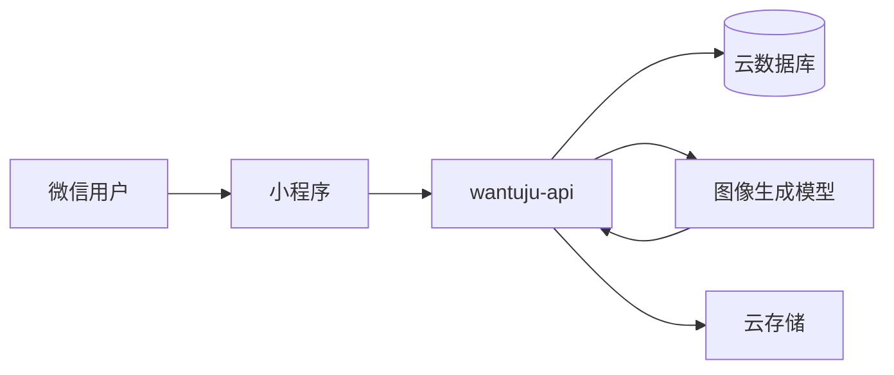

# 玩图局

[English](README.md) | 中文

玩图局是一个开源的微信小程序图片玩法合集。用户上传照片并选择玩法，后端把这张照片交给图像生成大模型改造或解读，生成结果可以保存和分享。

小程序不直接调用模型。Python FastAPI 服务 `cloudrun/wantuju-api` 跑在微信云托管上，负责提示词、模型请求、积分和云存储。新玩法是一份提示词配置，不需要为每个玩法发一版客户端。

## 玩法

- **看手相。** 上传手掌照片，生成趣味手相解读。
- **设计发型。** 上传正面照片，生成发型建议图。
- **头像生成。** 把人像收成可用的头像。
- **涂鸦风。** 把手绘或照片转成涂鸦插画。
- **蜡笔风。** 用蜡笔笔触重绘一张照片。
- **灵魂画像。** 按照片气质生成一张画像。
- **老照片修复。** 修复褪色、破损的旧照片。
- **风格转换。** 把照片换成另一种画风。
- **宠物拟人。** 给宠物生成拟人形象。
- **节日写真。** 按节日主题生成一张写真。
- **商品图。** 把商品照片整理成干净的展示图。

新玩法在管理端写好提示词即可上线，不用为每个玩法发一版小程序。
- **本地图片工具。** 切图和拼长图用 Pillow 完成，不调用生成模型。
- **账号与积分。** 微信登录、初始积分、每次生成消耗 1 积分，失败自动退款。
- **记录与分享。** 保存到相册、分享，并查看历史任务。

## 图像生成

每个生成类玩法都有自己的提示词。运行时用请求参数替换 `${变量}`，再把原图和渲染后的提示词一起发给模型。

模型调用使用 OpenAI 官方 Image API。原图和渲染后的提示词发到 [`POST https://api.openai.com/v1/images/edits`](https://developers.openai.com/api/docs/guides/image-generation)，模型为 `gpt-image-2`：

```http
POST /v1/images/edits HTTP/1.1
Host: api.openai.com
Authorization: Bearer $OPENAI_API_KEY
Content-Type: application/json
```

```json
{
  "model": "gpt-image-2",
  "prompt": "根据这张照片生成一张海报...",
  "images": [
    { "image_url": "https://..." }
  ]
}
```

服务随后会：

1. 用 Bearer Token 发送原图和提示词。
2. 对暂时性 HTTP 错误重试，最多 3 次，单次超时 300 秒。
3. 从 [Images 响应](https://developers.openai.com/api/docs/guides/image-generation) 的 `data[0].b64_json` 读取生成图。
4. 解码后写入云存储。
5. 把任务标为完成；生成失败则退回积分。

上传图还可以在扣积分前用另一条视觉提示词做检查，让模型按玩法要求只回答是否符合。检查和生成的提示词都在管理端修改，不写死在各个玩法里。

实现见 [`cloudrun/wantuju-api/app/services/poster.py`](cloudrun/wantuju-api/app/services/poster.py) 和 [`cloudrun/wantuju-api/app/services/tasks.py`](cloudrun/wantuju-api/app/services/tasks.py)。

## 架构



| 层级 | 职责 |
| --- | --- |
| 小程序 | 微信原生客户端。上传照片、展示进度、保存和分享结果。 |
| `cloudrun/wantuju-api` | Python 3.11 + FastAPI。玩法、任务队列、积分、管理端。 |
| 图像模型 | OpenAI Image API，`POST /v1/images/edits`，模型 `gpt-image-2`。 |
| 云开发 | 数据库、文件存储，以及云托管服务 `wantuju-api`。 |

小程序通过 `wx.cloud.callContainer` 调用服务。`cloudfunctions/quickstartFunctions` 和 `server/` 是旧链路，只作历史保留。

## 快速开始

### 小程序

1. 用微信开发者工具打开本仓库。
2. 在 `project.config.json` 填入你自己的 AppID。
3. 在 `miniprogram/app.js` 填入你的云开发环境。
4. 部署云托管服务 `wantuju-api` 后编译预览。

### API

```bash
cd cloudrun/wantuju-api
uv sync
uv run python -m uvicorn app.main:app --host 0.0.0.0 --port 8012
```

在 `cloudrun/wantuju-api` 下创建本地 `.env`，不要提交。

```env
CLOUDBASE_ENV_ID=<你的云开发环境 ID>
CLOUDBASE_APIKEY=<CloudBase HTTP API Bearer Token>
CLOUDBASE_DB_INSTANCE=flexdb
CLOUDBASE_DB_NAME=<你的云数据库名>

MEMEFAST_API_KEY=<OpenAI API Key>
MEMEFAST_API_URL=https://api.openai.com/v1/images/edits
MEMEFAST_MODEL=gpt-image-2

ADMIN_SESSION_SECRET=<随机字符串>
ADMIN_PASSWORD=<管理端密码>
```

`MEMEFAST_API_URL` 使用官方图像编辑接口 `https://api.openai.com/v1/images/edits`。`MEMEFAST_MODEL` 为 `gpt-image-2`。

部署、接口和管理端见 [cloudrun/wantuju-api/README.md](cloudrun/wantuju-api/README.md)。

## 目录

```text
miniprogram/                 微信小程序
cloudrun/wantuju-api/         当前 API：模型调用、任务、积分、管理端
cloudfunctions/              旧云函数
server/                      旧 FastAPI 服务
docs/                        设计笔记和旧链路退场清单
```

## 小程序接口

| 路径 | 作用 |
| --- | --- |
| `GET /health` | 健康检查 |
| `GET /miniapp/features` | 已启用玩法 |
| `GET /miniapp/me` | 当前用户和积分 |
| `POST /miniapp/tasks` | 创建生成任务 |
| `GET /miniapp/tasks` | 任务列表 |
| `/miniapp/share-reward/*` | 分享奖励和每日签到 |
| `/admin/*` | 管理端 |

## 参与贡献

欢迎提交 Issue 和 Pull Request，尤其是新玩法提示词、模型服务商和小程序流程。密钥放在环境变量里。`.env`、`server/.env` 和 `project.private.config.json` 已被 git 忽略。
